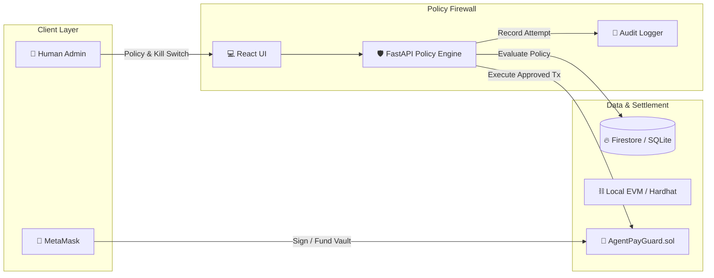

<div align="center">

# 🔐 AgentPay Guard

### *Secure, Policy-Enforced Autonomous AI Payments*

A security-first control and execution layer for AI agents that prevents financial overspending, unauthorized counterparties, and prompt-injection exploits.

[](https://www.python.org/)
[](https://fastapi.tiangolo.com/)
[](https://react.dev/)
[](https://vite.dev/)
[](https://soliditylang.org/)
[](https://hardhat.org/)
[](https://firebase.google.com/)

[**Live Demo**](https://agentpay-guard-a30d.onrender.com) • [**API Docs (Local)**](http://localhost:8000/docs) • [**Report Bug**](https://github.com/)

---

</div>

## 📌 Problem & Solution

Autonomous AI agents given financial authority are vulnerable to **prompt injection, jailbreaks, and model hallucinations**. Relying solely on prompt instructions ("do not spend more than \$50") is fundamentally unsafe.

**AgentPay Guard** inserts an independent, server-side policy firewall between the AI agent and the payment settlement layer. The AI agent can *propose* payments, but it **never holds private keys, never touches credentials, and cannot bypass deterministic policy rules**.

> [!IMPORTANT]
> **Core Principle**: The AI agent is untrusted. Hard spending limits, merchant allowlists, and emergency kill switches are enforced server-side and on-chain before money moves.

---

## 🏗 Architecture & Security Model



### 4-Tier Policy Pipeline

Every payment request must pass four consecutive deterministic gates:

1. **Agent Status Check**: Rejects immediately if the agent is frozen via the emergency kill switch.
2. **Allowlist Verification**: Verifies recipient against approved merchant addresses and categories.
3. **Per-Transaction Ceiling**: Blocks requests that exceed the agent's single-tx cap.
4. **Cumulative Daily Budget**: Enforces rolling daily spend caps across all requests.

---

## ⚡ Quick Start

### Prerequisites
- **Node.js**: v18.0 or higher
- **Python**: 3.12 or higher
- **MetaMask**: Connected to `Localhost 8545` (Chain ID: `31337`)

### 🚀 One-Click Launch (Windows Recommended)

Start all services (Hardhat node, contract deployment, FastAPI backend, and Vite frontend) with a single command:

```cmd
./run.bat
```

> [!TIP]
> **Interactive Controls**: While `run.bat` is running, press **`O`** to open the dashboard, **`D`** for Swagger docs, or **`S`** to stop all background processes cleanly. You can also run `stop.bat` anytime.

### 🐧 Cross-Platform / Manual Launch

<details>
<summary>Click to view step-by-step terminal commands</summary>

```bash
# 1. Start Local Blockchain & Deploy Contract
npx hardhat node
# In a second terminal:
npx hardhat run scripts/deploy.js --network localhost

# 2. Start FastAPI Backend (Port 8000)
cd backend
python -m venv venv
# Windows: .\venv\Scripts\Activate.ps1 | Linux/macOS: source venv/bin/activate
pip install -r requirements.txt
uvicorn app.main:app --reload

# 3. Start Frontend Dashboard (Port 5173)
cd frontend
npm install
npm run dev
```

</details>

---

## ⚙️ Configuration (`backend/.env`)

Copy the template to create your local environment file:

```bash
cp backend/.env.example backend/.env
```

| Variable | Default | Purpose |
| :--- | :--- | :--- |
| `IS_BLOCKCHAIN_ENABLED` | `true` | Enables EVM smart contract settlement |
| `RPC_PROVIDER_URL` | `http://127.0.0.1:8545` | Hardhat or EVM RPC endpoint |
| `SMART_CONTRACT_ADDRESS` | `0x5FbDB2...` | Deployed `AgentPayGuard.sol` address |
| `FIREBASE_CREDENTIALS_PATH` | `firebase-key.json` | Path to Firebase service account file |
| `DEFAULT_PER_TRANSACTION_LIMIT` | `1000.0` | Default single-transaction ceiling ($) |
| `DEFAULT_DAILY_LIMIT` | `5000.0` | Default 24-hour spend budget ($) |

> [!NOTE]
> Ensure `firebase-key.json` is placed in `backend/` with Cloud Firestore enabled in your Firebase console.

---

## 🔌 Core API Endpoints

Interactive Swagger documentation is available at `http://localhost:8000/docs`.

| Method | Endpoint | Description |
| :--- | :--- | :--- |
| `GET` | `/api/v1/agents` | List all monitored AI agents & financial telemetry |
| `POST` | `/api/v1/payments` | Submit an AI payment request for policy evaluation |
| `POST` | `/api/v1/agents/{id}/freeze` | **Emergency Kill Switch** — Instantly freeze agent funds |
| `POST` | `/api/v1/agents/{id}/unfreeze` | Restore agent payment authority |
| `PUT` | `/api/v1/agents/{id}/policy` | Update per-transaction and daily limits |
| `POST` | `/api/v1/agents/{id}/allowlist` | Add verified merchant address to whitelist |
| `GET` | `/api/v1/agents/{id}/transactions`| Retrieve complete audit trail & evaluation logs |

---

## 📁 Repository Structure

```text
AgentPay-Guard/
├── backend/
│   ├── app/
│   │   ├── api/endpoints/     # FastAPI routes (agents, payments, policy)
│   │   ├── core/              # Security, settings & database configuration
│   │   ├── models/            # Domain models (Agent, Merchant, Transaction)
│   │   └── services/          # Policy engine, blockchain & allowlist services
│   ├── firebase-key.json      # Firebase credentials (git-ignored)
│   └── requirements.txt       # Python dependencies
├── frontend/
│   ├── src/                   # React 19 + Vite dashboard application
│   └── package.json
├── contracts/
│   └── AgentPayGuard.sol      # Solidity smart contract guard vault
├── scripts/
│   └── deploy.js              # Hardhat deployment & auto-sync script
├── run.bat                    # Unified one-click runner (Windows)
├── stop.bat                   # Clean shutdown script
└── README.md
```

---

## 📄 License

This project is licensed under the [MIT License](LICENSE).
